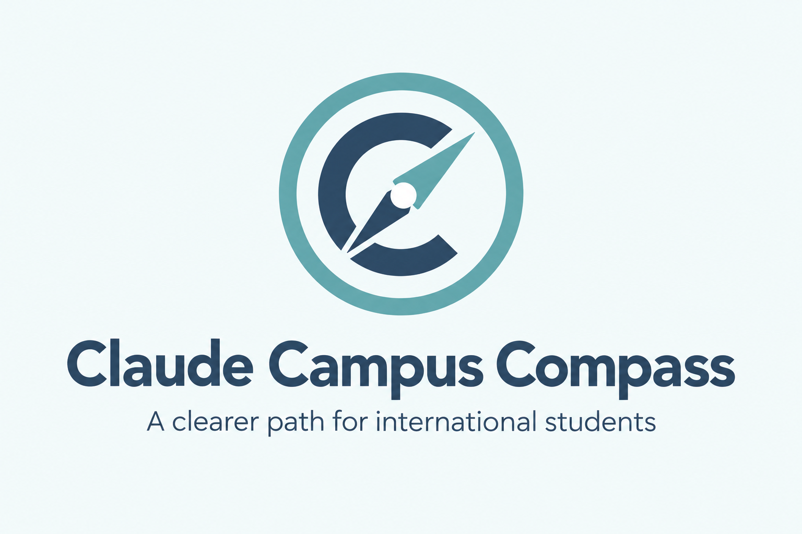
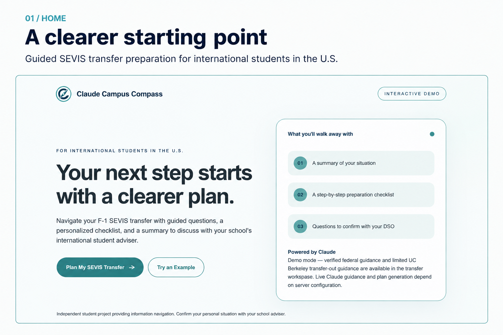
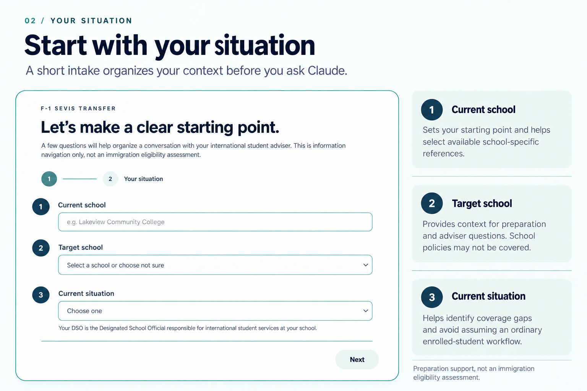
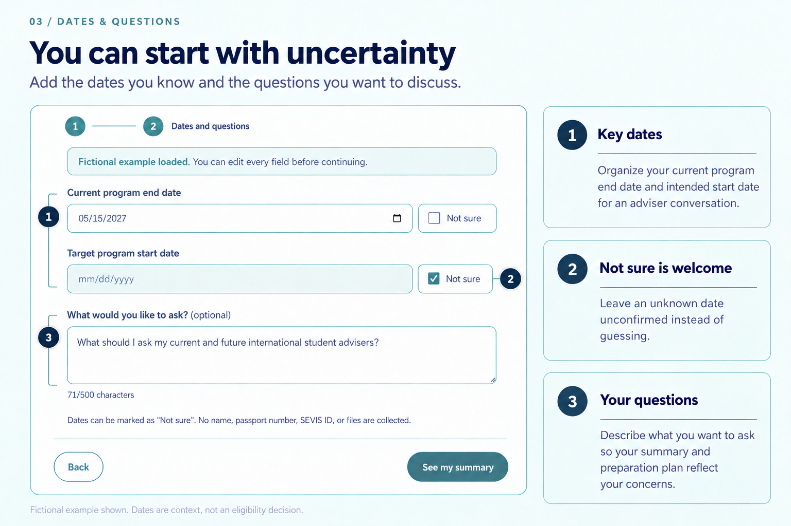
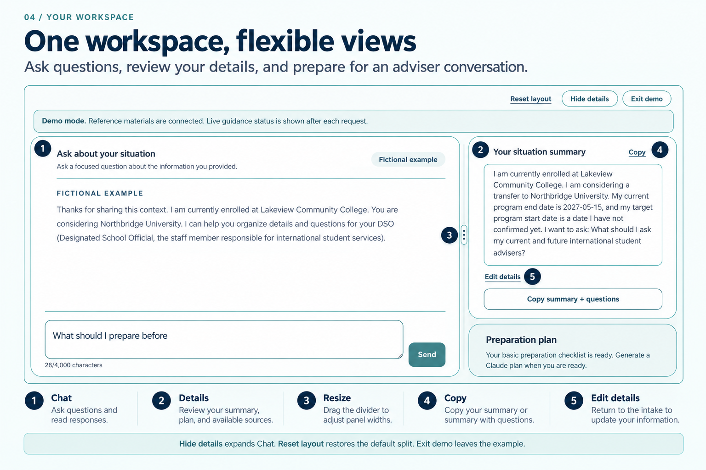
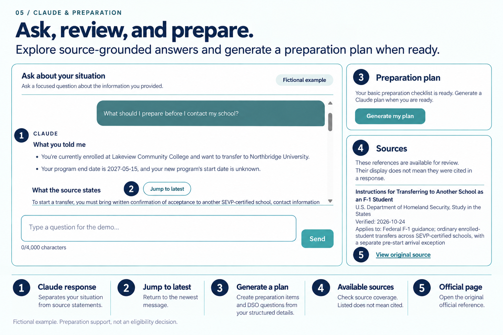
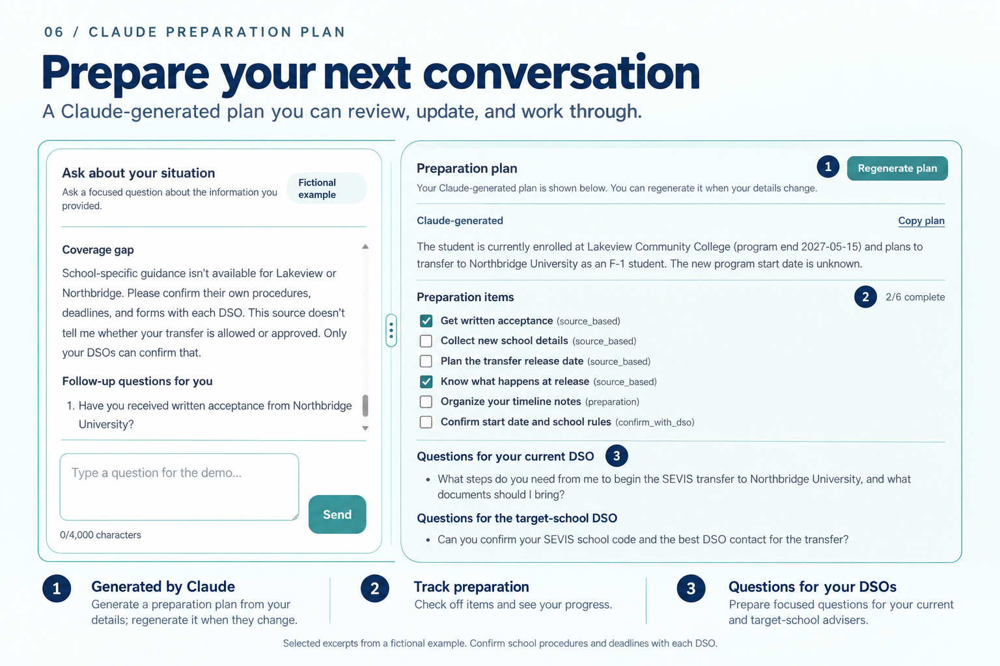
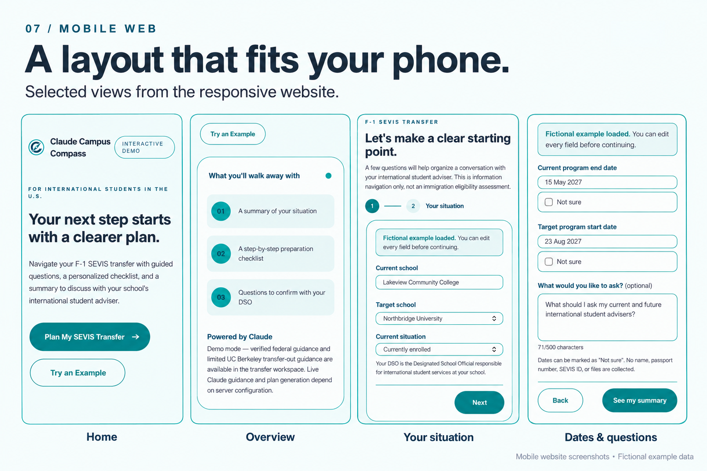
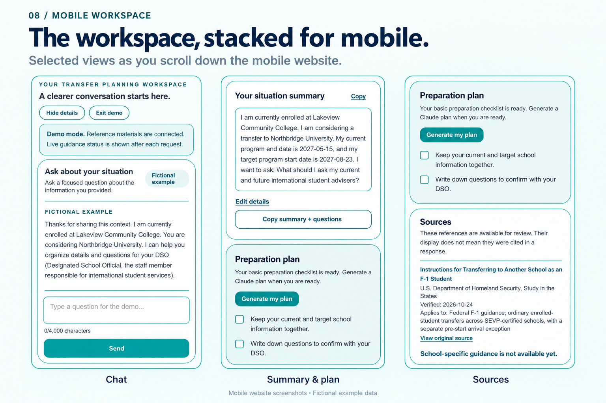

<h1 align="center">Claude Campus Compass</h1>

<p align="center">
  <a href="https://youtu.be/9cACY0B8GlI">
    
  </a>
</p>

<p align="center">
  <a href="https://youtu.be/9cACY0B8GlI"><strong>▶ Watch the demo on YouTube</strong></a>
  &nbsp;·&nbsp;
  <a href="https://claude-campus-compass.vercel.app">Try the live site</a>
</p>

Claude Campus Compass is an information-navigation tool for international
students in the United States. Its current MVP focuses on preparing for an
F-1 SEVIS transfer: organizing a student's situation, finding the right
questions for a school adviser, and explaining a small set of reviewed
reference materials.

Students often have to combine federal guidance with school-specific
instructions, while transfer procedures and required conversations differ by
school and situation. This project helps make that preparation more
structured. Claude can organize the information a student provides, explain
the supplied reference text, show citations when a chat answer uses a source,
and generate an on-demand preparation plan.

The product does **not** assess immigration eligibility, give legal
conclusions, approve a transfer, or replace a Designated School Official (DSO)
or qualified immigration attorney.

## Product walkthrough

The screens below use the app's clearly marked fictional example data
(Lakeview Community College and Northbridge University are not real student
records). Select a group heading to expand or collapse it.

<details open>
<summary><strong>Desktop walkthrough (01–06)</strong></summary>

**01 · Home.** Two entry points: plan your own SEVIS transfer, or try a
clearly marked fictional example.



**02 · Your situation.** The first intake step asks for the current school,
target school, and current situation. The current school decides which
reviewed school-specific references apply; the target school adds context
only.



**03 · Dates and questions.** Program dates can be left as "Not sure," and an
optional question shapes the summary and plan. The form does not ask for a
name, passport number, SEVIS ID, or files.



**04 · Transfer workspace.** Chat sits beside a Details panel with the
situation summary and preparation plan. Drag the divider to resize, hide
Details to widen the chat, or use Reset layout to restore the default split.



**05 · Ask and review sources.** Claude's reply separates what the student
said from what the supplied source states. The Sources panel lists the
references available for review; being listed does not mean a reference was
cited in a particular reply.



**06 · Preparation plan.** On request, Claude prepares a plan with checkable
items labeled by basis type, plus questions for the current and target-school
DSOs. Regenerate it after details change. The chat also flags coverage gaps
when school-specific guidance is not available.



</details>

<details>
<summary><strong>Mobile layout (07–08)</strong></summary>

**07 · Mobile home and intake.** The home page, overview, and both intake
steps on a phone-width screen.



**08 · Mobile workspace.** Chat, the summary and plan, and Sources stack in
normal page flow so the page scrolls naturally.



</details>

## Live demo and quick start

**Live demo:** [claude-campus-compass.vercel.app](https://claude-campus-compass.vercel.app)

The home page offers two paths:

- **Plan My SEVIS Transfer** starts with blank fields for a student's own
  situation.
- **Try an Example** opens the same flow with clearly marked fictional data.
  It is useful for testing the interface, but it is not a real student's
  record. If live AI is enabled, chat and plan requests made from example mode
  still consume the deployment's shared AI request limits.

The transfer workspace flow is:

1. Enter the current school, target school, current situation, dates, and
   optional questions.
2. Review the structured situation summary.
3. Ask a focused question in the chat workspace.
4. Read the response and, when the response contains citations, open the
   per-answer **Sources** section to inspect the cited excerpt and original
   URL.
5. Select **Generate my plan** when a plan is useful. Generation is explicit;
   it does not run after every chat message.
6. Review and check preparation items, copy the plan or summary, and edit
   details when needed.
7. If structured details change, the existing plan is marked **Out of date**.
   Regenerate it before treating it as current; an out-of-date plan cannot be
   copied.

Chat and plan state is held in page memory. Refreshing the page clears the
chat, generated plan, and checked plan items. On desktop, **Details** toggles
the summary, preparation plan, and reference panel; hiding it expands the
chat across the main content area. On mobile, the chat and Details content are
stacked in normal document flow so the page can scroll naturally.

On desktop (1024 px and wider), while Details is visible, a vertical separator
splits the workspace about 70% chat / 30% Details:

- **Resize:** drag the separator, or focus it and use the Left/Right arrow
  keys; Home/End jump to either limit. Left enlarges Details and Right
  enlarges Chat.
- **Limits:** Chat keeps at least 440 px and Details at least 280 px. If the
  workspace is too narrow for both, the panels stack without a separator.
- **Reset:** **Reset layout**, or a double-click on the separator, restores
  the default split.
- **Memory:** the chosen split is kept in page memory only. It survives
  hiding and showing Details, Edit details, and window resizing, where widths
  are clamped to the limits. Refreshing the page resets it.

Mobile and tablet widths keep the stacked layout with no separator.

## Current capabilities and coverage

Implemented now:

- Guided F-1 transfer intake form with validation for structured student data.
- Fictional example mode kept separate from real Claude response labels.
- Situation summary, basic preparation checklist, editable details, and
  in-memory checklist state.
- Server-controlled Claude chat with a 20-second SDK timeout, no SDK retries,
  citation blocks, citation validation, safe Markdown rendering, and a
  max-token truncation warning. Each citation marker number matches the
  numbered entry in that answer's **Sources** list. Links written by the model
  are clickable only when they match a server-provided reference URL;
  other link text is shown as plain text.
- Multi-turn chat context: each request sends the most recent answered
  question/Claude-reply pairs plus the new question, within the server's
  20-message limit. Demo, service-status, and error messages are never sent.
  A question that received an error or status response instead of an answer
  is marked "Not answered" and is left out of later context; its
  "Put question back in the message box" control refills the input without
  sending automatically.
- Explicit structured preparation-plan generation with a 60-second SDK
  timeout, no SDK retries, up to six preparation items, and up to three
  current-DSO and target-school-DSO questions each. Plan errors are reported
  by cause:
  - output cut off: `stop_reason` is `max_tokens` or
    `model_context_window_exceeded`;
  - unreadable structured output, with no truncation evidence;
  - refusal;
  - configuration problems (authentication, permission, or unknown model);
  - rejected requests;
  - timeouts.

  **Retry** is shown only for errors where trying again may help.
- Opening **Edit details** while a plan is generating cancels that browser
  request and explains the cancellation, so it cannot overlap with a
  regeneration. Responses from an earlier plan request never change the
  current plan, error, or loading state. Cancelling stops the browser
  request and is passed to the Claude SDK where the platform propagates
  the request signal. It does not guarantee that upstream processing or
  billing stops.
- Accessibility: the workspace heading receives focus on entry. Plan
  checkboxes are labelled by their item titles. Two polite live regions
  announce only the current loading state, the newest chat reply or service
  status, and plan status, not the whole conversation.
- Plan item basis types:
  `source_based`, `preparation`, and `confirm_with_dso`.
- Server-side source selection and reference-ID validation. The browser
  receives public reference metadata, not the complete `sourceText`.
- Request body validation, chat-history limits, endpoint rate protection, and
  an `AI_REQUESTS_ENABLED` server switch. Text fields are limited to 500
  characters and chat messages to 4,000 characters on both the client and the
  server. The current situation must be one of the five supported values.
- Responsive consultation layout with desktop internal scrolling, a
  resizable desktop chat/Details split, and a mobile layout that remains
  naturally scrollable.

Current reviewed coverage:

- Federal F-1 guidance for ordinary enrolled-student transfers between
  SEVP-certified schools, including a separately identified pre-start arrival
  exception.
- UC Berkeley transfer-out guidance only when the **current school** is
  precisely matched as UC Berkeley or an implemented alias. Berkeley City
  College, another school whose name contains “Berkeley,” and an unqualified
  “Berkeley” are not automatically treated as UC Berkeley.
- The target school name does not mean that the target school's transfer-in
  policy has been integrated. School-specific transfer-in guidance is not
  currently represented by the UC Berkeley source.
- Other school-specific procedures and a complete OPT-specific transfer
  workflow are not covered. Currently on OPT, Completed my program, Other, and
  Not sure are treated as outside the documented ordinary enrolled-student
  workflow. Each shows a coverage notice, and the application is instructed
  to focus on preparation information and questions for a DSO rather than
  present the ordinary enrolled-student workflow as a complete answer. Their
  generated plans cannot contain `source_based` items.
- An ICE/SEVP reference remains in the review collection as `unverified` and
  is excluded from the active answer reference set.

Chat citations and plan references are different:

- A chat answer contains citation blocks only for sources that the upstream
  response actually cited and that the server successfully mapped to a
  supplied reference.
- A generated plan includes reference IDs attached to validated
  `source_based` items and a list of available background references. Those
  references do not claim that every listed source was quoted in the plan.
- Reference-ID rule: only `source_based` items carry reference IDs, and only
  they show a "Source basis" line. Any unknown reference ID rejects the plan.
  Valid reference IDs returned on `preparation` or `confirm_with_dso` items are
  removed by the server, so those items never imply verified source support.

Not implemented or intentionally out of scope:

- J-1, CPT, or expanded visa-status workflows.
- A complete OPT-specific action plan.
- Automatic student-status updates inferred from chat.
- Persistent accounts, database storage, or persistent chat/plan history.
- Real-time school-policy crawling or general legal/eligibility decisions.

## Local development

Run these commands from the project root.

The project uses Next.js `16.4.3`, React `19.3.0`, TypeScript, Tailwind CSS,
the Anthropic TypeScript SDK, and the Upstash Redis SDK.

Node.js requirements:

- Running and building the app: Node.js `20.9.0` or newer, as required by
  the installed Next.js.
- Running the offline tests (`npm.cmd test`): Node.js `22.18.0` or newer,
  which provides type stripping enabled by default and `module.registerHooks`.
- Recommended for development: Node.js `22.18.0` or newer, so both work. The
  current checks were run with Node.js `24.16.0`.

```powershell
npm.cmd install
npm.cmd run dev
```

Open [http://localhost:3000](http://localhost:3000).

Create and run the production build locally:

```powershell
npm.cmd run build
npm.cmd run start
```

Available checks:

```powershell
npm.cmd test
npm.cmd run lint
npx.cmd tsc --noEmit
npm.cmd run build
git diff --check
```

`npm.cmd test` runs the committed offline regression tests in `tests/` with
Node's built-in test runner and type stripping (Node.js 22.18 or newer; no
extra dependencies). `tests/register-hooks.mjs` resolves the `@/` import alias
and replaces `fetch` with a function that throws, so the tests cannot contact
Anthropic, Upstash, or any other service. They do not read `.env.local`.
`npm.cmd run build` downloads the Geist fonts through `next/font/google`, so a
normal build needs network access.

Create local configuration from the example without committing secrets:

```powershell
Copy-Item .env.example .env.local
```

Fill the required values locally, then restart the development server after
changing them. Do not read, print, commit, or upload `.env.local` as part of
development or troubleshooting.

## Environment variables and Claude API setup

Copy the names from [.env.example](./.env.example). Use placeholders only:

| Variable | Purpose | Sensitive? | Required when |
| --- | --- | --- | --- |
| `ANTHROPIC_API_KEY` | Server-side authentication for Claude | Yes | A live chat or plan request is desired |
| `ANTHROPIC_MODEL` | Model ID passed to the Anthropic SDK | No, but deployment-specific | A live chat or plan request is desired |
| `AI_REQUESTS_ENABLED` | Server-side paid-AI master switch | No | Must be exactly `true` to allow requests |
| `UPSTASH_REDIS_REST_URL` | Upstash Redis REST endpoint | Sensitive configuration | Preview/Production shared limiting |
| `UPSTASH_REDIS_REST_TOKEN` | Upstash Redis REST authentication token | Yes | Preview/Production shared limiting |

`AI_REQUESTS_ENABLED` is parsed strictly: only the exact string `true`
enables requests. Missing, empty, `false`, `TRUE`, or any other value disables
AI requests.

The application does not hard-code or guess a model ID. Choose a model
available to the account from Anthropic's [models
documentation](https://docs.anthropic.com/en/docs/about-claude/models) or the
Anthropic Console. For key management, see Anthropic's [API
keys](https://docs.anthropic.com/en/api/getting-started#api-keys)
documentation.

Anthropic keys and Redis credentials are server-only. Never rename them with a
`NEXT_PUBLIC_` prefix. `.env.local` is a local file and is not automatically
uploaded to Vercel; configure deployment variables in the Vercel project
settings instead. Restart local development after changing variables. Vercel
environment-variable changes apply to new deployments, so redeploy after
changing them.

If the AI switch is disabled, the request is paused before its body is read.
If the Anthropic key or model is missing, a valid request returns
`not_configured` without calling Claude and without consuming the shared AI
quota.

## Upstash Redis and request protection

For Preview and Production:

1. Create an Upstash Redis database in the [Upstash
   Console](https://console.upstash.com/).
2. From the database details, copy its REST URL and a writable REST token.
   Upstash's [Redis getting-started
   guide](https://upstash.com/docs/redis/overall/getstarted) describes the
   setup.
3. Set `UPSTASH_REDIS_REST_URL` and `UPSTASH_REDIS_REST_TOKEN` as server-side
   Vercel variables. The app uses the official
   [`@upstash/redis`](https://upstash.com/docs/redis/howto/connect-with-upstash-redis)
   package.

Each AI route handles a request in this order:

1. Check the AI switch.
2. Read the body, up to the limit.
3. Validate the request.
4. Check that the key and model are configured.
5. Take the shared quota.
6. Call Claude.

Invalid, oversized, paused, and unconfigured requests therefore do not
consume the shared AI invocation quota. Such requests are bounded only by the
body limits and platform limits. This is not comprehensive abuse prevention.

The guard uses one atomic Redis script before the Claude call:

| Endpoint | UTC minute limit | UTC day limit |
| --- | ---: | ---: |
| `/api/chat` | 12 | 100 |
| `/api/plan` | 4 | 20 |

These are whole-application limits across users and instances. They are not
per-user quotas and are not an exact dollar budget. Short-term or daily
exhaustion returns HTTP `429` with a `Retry-After` value. The UI distinguishes
short-term waiting from the next-UTC-day limit. When this server instance is
already processing its maximum number of concurrent AI requests, it returns
HTTP `429` with status `busy`. The UI shows a separate "still being processed"
message for this case, not a rate-limit message.

The existing request-body limits are listed below. The body is read in chunks
and reading stops once the limit is exceeded, even without a `Content-Length`
header.

- Chat: 256 KiB.
- Plan: 64 KiB.
- Chat history: at most 20 messages, with each message at most 4,000
  characters.

Chat uses a 20-second SDK timeout and a 30-second route limit. Plan generation
uses a 60-second SDK timeout and a 70-second route limit. Both Claude clients
have `maxRetries: 0`; the UI offers manual retry but does not automatically
resend paid requests.

Preview/Production fail closed with HTTP `503` when Redis configuration is
missing or Redis is unavailable/times out. The application does not allow the
Claude call to bypass shared protection in those cases. Local development
without Redis configuration uses the in-memory request guard instead. That
fallback is limited to one running process and is not global protection for
multiple Vercel instances. The implementation retains a per-instance
concurrency cap; it is not a global concurrency limit.

Testing history and current coverage:

- **Historical checks (not in the repository):** during development, temporary
  offline mock tests for the request guard covered allow, minute limit, daily
  limit, Redis exception, Redis timeout, missing production configuration, and
  the paused switch. They were run, then deleted, and are not committed.
- **Committed tests (`npm.cmd test`):** chat-history building and limits,
  route rejection of oversized or over-long history and unsupported
  situations, situation and field-length validation, restricted-status
  coverage notices, plan validation (duplicate item IDs, reference-ID rule,
  restricted `source_based` items), citation numbering, and approved-link
  filtering. They also cover:
  - route ordering: invalid, oversized (including chunked bodies without
    `Content-Length`), paused, and unconfigured requests do not touch the
    quota;
  - Redis-exception and missing-production-configuration fail-closed
    responses;
  - busy versus rate-limit responses;
  - plan error classification from mocked Anthropic responses: truncation,
    parse failure, refusal, configuration, rejected requests, and
    cancellation;
  - stale-request tracking and live-region text;
  - desktop split-pane ratio calculation, minimum-width clamping, and keyboard
    steps.

  Redis is a local mock, and Anthropic responses come from a mocked `fetch`.
  The minute limit, daily limit, and Redis timeout paths are not yet covered
  by committed tests.

Live multi-instance, hosted Redis-failure, and production-quota behavior still
need deployment-specific verification.

## Vercel deployment

### Import and build

1. Import the GitHub repository into Vercel.
2. Use the Next.js framework preset.
3. Keep the repository root as the project root; the app is not in a
   subdirectory.
4. Use the package scripts already in `package.json`. The production build is
   `npm.cmd run build`; Vercel normally detects the equivalent build command
   automatically.
5. Configure all server-side variables from the table above in the appropriate
   Vercel environments.

The checked-in [vercel.json](./vercel.json) sets the configured Vercel
Function region to `sfo1`:

```json
{
  "$schema": "https://openapi.vercel.sh/vercel.json",
  "regions": ["sfo1"]
}
```

This is a deployment configuration value, not proof of the physical region
used by every request. Confirm the deployed function region and the plan's
regional capabilities in Vercel. Vercel's [Function region
documentation](https://vercel.com/docs/functions/configuring-functions/region)
notes that supported regions depend on the account plan.

The route code requests 30 seconds for chat and 70 seconds for plan generation.
The actual platform limit depends on the deployed Vercel plan and current
Vercel behavior; do not assume a plan permanently supports a particular
duration. Check Vercel's [function
limits](https://vercel.com/docs/functions/limitations) before enabling live
requests.

For a safer first deployment:

1. Set `AI_REQUESTS_ENABLED=false` for Preview and Production.
2. Deploy and verify the public pages, form flow, and static/reference
   behavior.
3. Confirm the server-side variables and Upstash database configuration.
4. Enable `AI_REQUESTS_ENABLED=true` only for Production after the checks.
   Keep Preview set to `false` unless Preview traffic is intentionally
   allowed to consume the shared quota.
5. Redeploy after changing Vercel environment variables.

With a Git-connected Vercel project, pushes to branches create Preview
deployments and updates to the production branch (commonly `main`) create a
Production deployment. See Vercel's [Git deployment
documentation](https://vercel.com/docs/git).

After deployment, manually check:

- The public home page and `/transfer` load.
- A normal student flow and the fictional **Try an Example** flow.
- Chat responses, citation markers, and expandable cited excerpts.
- Preparation-plan generation, item checkboxes, copy behavior, and stale-plan
  handling after editing details.
- Redis production counters for the expected whole-application keys.
- The desktop Details toggle and the mobile layout at representative phone
  widths.
- The deployed function region and actual route duration support.

## Architecture and API overview

Important areas:

- `app/page.tsx`: home page and entry points.
- `app/transfer/page.tsx`: intake flow, consultation workspace, Markdown and
  citation display, plan controls, and in-memory UI state.
- `lib/transfer/`: shared transfer types, formatting, checklist logic, input
  validation and limits, supported/restricted situation definitions, chat
  history building, and citation numbering/approved-link helpers.
- `tests/`: committed offline regression tests and the Node test loader hook.
- `lib/references/`: reviewed reference records, precise school matching, and
  public metadata conversion.
- `lib/chat/claude-service.ts`: server-only Claude client, system prompt,
  document citations, error mapping, and response truncation handling.
- `lib/chat/plan-service.ts`: server-only structured-plan schema, prompt,
  source-ID validation, status-specific coverage rules, and plan limits.
- `lib/server/ai-guard.ts`: AI switch, body-size checks, in-memory fallback,
  Upstash atomic minute/day limits, and fail-closed responses.
- `app/api/`: public server route handlers.

### API routes

#### `POST /api/chat`

Accepts the latest structured `studentData` and a bounded `messages` array
whose roles are `user` or `assistant`. The server validates the payload,
selects applicable active references, sends only the server-controlled prompt
and references upstream, and maps validated citation blocks back to reference
metadata.

Common responses:

- `200`: `ready`, `not_configured`, or a structured service result.
- `400`: invalid JSON, student data, or chat history.
- `413`: request body too large.
- `429`: shared minute or daily limit reached (`rate_limited`), or this
  instance is busy with another AI request (`busy`).
- `503`: AI paused or shared Redis protection unavailable.
- `502`: an upstream Claude service error.

#### `POST /api/plan`

Accepts the latest structured `studentData` only. It does not read chat
history or infer structured facts from prior messages. The server chooses
applicable references and asks Claude for the validated structured fields:
situation summary, missing information, preparation items, DSO questions, and
coverage limits.

Each item contains an ID, title, short description, basis type, and reference
IDs. The server rejects unknown reference IDs, duplicate item IDs, unsupported
`source_based` items for OPT/Completed my program/Other/Not sure statuses,
missing restricted-status coverage limits, excessive item/question counts, and
invalid item descriptions. It removes reference IDs from non-`source_based`
items.

It uses the same common error classes as chat where applicable, plus
plan-specific failures:

- truncation, reported only when `stop_reason` confirms it;
- unreadable structured output;
- refusal;
- plan validation failures;
- timeouts.

Each error response includes `retryable`. A successful
plan includes server-resolved reference metadata; URLs, titles, publishers,
and IDs are not generated by the model.

#### `GET /api/references`

Accepts school and situation query parameters and returns the server-selected
public reference metadata, notices, and school-match results. It does not
return the complete `sourceText`. `unverified` references are not included in
the active answer collection.

## Privacy, limitations, and troubleshooting

The current UI keeps form data, chat messages, plan results, and checked plan
items in browser memory for the current page. Refreshing clears them. There is
no account or persistent application database in this MVP.

Server logs intentionally record operational numbers such as Claude stop
reason, token usage, plan validation code, and request duration. The current
Claude and plan logging paths do not log complete student profiles, chat
transcripts, answer text, secrets, or raw IP addresses. This does not mean
that Anthropic, Vercel, Upstash, browsers, or network providers never process
or retain data under their own terms. Review their current privacy,
retention, and billing documentation before using real personal information.

Common issues:

- **AI requests are paused:** set `AI_REQUESTS_ENABLED=true` exactly, then
  restart locally or redeploy after changing Vercel variables.
- **`not_configured`:** check that `ANTHROPIC_API_KEY` and
  `ANTHROPIC_MODEL` are present in the server environment. The key must not
  use `NEXT_PUBLIC_`.
- **Redis unavailable:** in Preview/Production, verify the REST URL, writable
  token, environment assignment, and redeployment. The service intentionally
  returns `503` instead of bypassing protection.
- **Request timed out:** the request has a bounded 20-second chat or 60-second
  plan timeout and no automatic upstream retry. Use the page's manual retry
  only after checking configuration and service availability.
- **Rate limit reached:** `429` distinguishes the shared UTC-minute limit from
  the shared UTC-day limit. Wait for the indicated period; do not repeatedly
  submit.
- **Plan is Out of date:** edit details changed the structured input. Generate
  a new plan before copying or relying on it.
- **Environment changes appear ineffective:** local changes require a server
  restart; Vercel changes require a new deployment. Confirm the variable is
  assigned to the intended Preview or Production environment.
- **School-specific guidance is missing:** only the implemented exact current
  UC Berkeley match receives the Berkeley transfer-out source. A target-school
  name alone does not add target-school policy.

## Development status and next steps

This is an early MVP with a working F-1 transfer-preparation flow, reviewed
federal and limited UC Berkeley source coverage, server-controlled Claude
chat/citations, explicit structured plan generation, and deployment safeguards.
It does not claim user-outcome, accuracy, or adoption metrics.

The next priorities are controlled trials with intended users, feedback on
clarity and workflow, and adding more school-specific material only after
source review and verification. Expanding coverage must not be treated as
implemented until the corresponding sources, matching rules, prompts, and
tests are updated.
